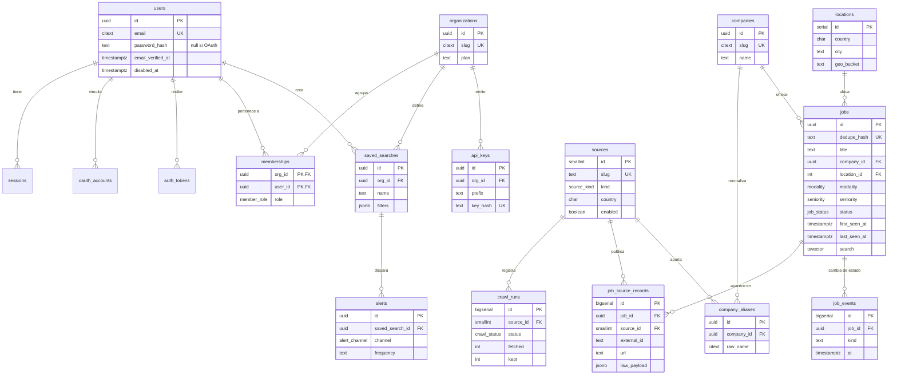

# DER del sistema

Plataforma de inteligencia de demanda laboral junior/trainee para LATAM. El schema ejecutable está en [db/schema.sql](../db/schema.sql); acá está el porqué de cada decisión.

## Diagrama

## Las cinco decisiones que importan

### 1. `jobs` (canónico) separado de `job_source_records` (por fuente)

Es la decisión central. La misma búsqueda aparece en Computrabajo, en GetOnBoard y en un portal que scrapea a los dos. Si guardás todo plano, el reclutador ve la misma oferta tres veces y las métricas de "cuántas búsquedas tiene abiertas ADN" salen infladas.

- `jobs` = la oferta como entidad del negocio: una.
- `job_source_records` = cada avistamiento con su URL, su `external_id` y el crudo.

Ventaja secundaria: si mañana se cae un scraper, esa fuente se puede purgar completa sin tocar la identidad de la oferta.

**Dedupe:** `jobs.dedupe_hash = sha1(company_id | title_normalizado | city | modality)`. El título normalizado es minúsculas, sin acentos, sin "ref. 21598" ni prefijos de portal. Cuando dos fuentes matchean el mismo hash, se crea **un** `jobs` y dos `job_source_records`.

### 2. `job_events` en vez de recalcular historia

`first_seen_at` / `last_seen_at` alcanzan para "¿está abierta?", pero el producto vende **"lleva 21 días abierta"** y "reabrió". Eso necesita transiciones con fecha. `job_events` es append-only: `opened`, `closed`, `reopened`, `updated`.

Regla de cierre: si una corrida completa de una fuente no ve la oferta, no se cierra en el acto (los portales fallan y paginan raro). Se cierra cuando pasan N corridas consecutivas sin verla, y ahí se escribe el evento.

### 3. `company_aliases`: el infierno de los nombres

"ADN - Recursos Humanos", "ADN RRHH" y "ADN" son el mismo empleador. Sin alias, agrupar por empresa —que es el reporte que se le vende a una consultora— es basura. La tabla guarda el nombre crudo tal como vino de cada fuente y apunta al canónico.

### 4. `sources` y `crawl_runs`: la fuente es un dato, no código

Agregar un portal no debería ser un deploy. `sources.config` guarda los parámetros (queries, variantes de URL, selectores) y `enabled` permite apagarla en caliente. `crawl_runs` da observabilidad: cuántas trajo, cuántas guardó, cuándo falló. Sin esto no podés decirle a un cliente "el dato está actualizado".

### 5. Multi-tenant desde el día uno

`organizations` + `memberships` aunque hoy haya un solo usuario. Agregar tenancy después implica reescribir cada query y cada índice por `org_id`. El costo hoy es una tabla y un join; el costo mañana es una migración de datos en producción.

## Lo que quedó afuera, a propósito

| Excluido | Por qué |
|---|---|
| **Candidatos / postulaciones / CVs** | Datos personales. Ley 25.326 (AR) y GDPR si tocás EU. Es otro producto y otro compliance: cifrado por campo, retención, derecho de supresión |
| **Pagos** | Se agrega con Stripe cuando haya cliente pagando. Un `plan` en `organizations` alcanza hasta entonces |
| **Scoring / matches** | Es cómputo, no modelo. Si hace falta, tabla `job_scores` aparte, regenerable |
| **Emails enviados** | Lo maneja el proveedor (Resend/SES). Solo guardamos `last_sent_at` |
| **Auditoría genérica** | Se agrega cuando haya algo que auditar (cambios de rol, exportaciones) |

## Índices que ya están puestos y por qué

- `jobs (status, last_seen_at desc)` — la consulta de la home: ofertas abiertas, recientes.
- `jobs using gin (search)` — búsqueda de texto en español sobre el título.
- `jobs (location_id, modality)` — el filtro que más se usa: "junior en CABA, presencial".
- `job_source_records (source_id, external_id)` único — idempotencia del scraper: correr dos veces no duplica.
- `sessions (expires_at)` — limpieza programada.

## Dudas que conviene resolver antes de crear las tablas

1. **`geo_bucket` como texto libre** ('AR-CABA', 'LATAM', 'GLOBAL') funciona hoy, pero si el producto vende "por ciudad" conviene una tabla `geo_buckets` con jerarquía. Se puede migrar después sin drama.
2. **`jobs.search` solo indexa el título.** Si el cliente busca por stack ("react"), hace falta una columna `skills text[]` con GIN o un `tsvector` que incluya descripción.
3. **`dedupe_hash` con `company_id`** falla si la empresa todavía no está normalizada al momento de insertar. El pipeline tiene que resolver company *antes* de calcular el hash, o usar un hash provisorio basado en el nombre crudo.
